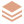
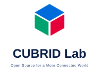

# CUBRID Lab icon gallery

These SVGs are generated by [`scripts/build.py`](../scripts/build.py) from [`tokens/`](../tokens/), [`registry/`](../registry/), and role constructions in the script. The [supplied infographic](studies/repository-icon-system-infographic.png) is the visual reference. It is not a source of SVG paths. Design selection and legal or trademark clearance are separate.

The four Driver variants, the Python ORM, MCP, and Cookbook icons (selected on 2026-10-14), the Go Operator icon (selected on 2026-10-15), and the TypeScript, Go, and Rust ORM icons (selected on 2026-10-20) are approved assets in `dist/icons/`. The maintainer selections are recorded in [issue #6](https://github.com/cubrid-lab/brand/issues/6). All other symbols below are individual review candidates in `studies/icons/`.

## Individual repository icons

| Role | Repository | Language token | Icon |
| --- | --- | --- | --- |
| Driver | `pycubrid` | Python |  |
| Driver | `cubrid-client` | TypeScript |  |
| Driver | `cubrid-go` | Go |  |
| Driver | `cubrid-rs` | Rust |  |
| ORM | `sqlalchemy-cubrid` | Python |  |
| ORM | `drizzle-cubrid` | TypeScript |  |
| ORM | `gorm-cubrid` | Go |  |
| ORM | `sea-orm-cubrid` | Rust |  |
| MCP | `cubrid-mcp-server` | Python |  |
| Cookbook | `cubrid-cookbook-python` | Python |  |
| Benchmark | `cubrid-benchmark` | Neutral |  |
| Operator | `cubrid-kubernetes-operator` | Go |  |
| Showcase | `showcase` | Neutral |  |

## Community surfaces

`docs` and `community` are concept surfaces in the registry, not claims that repositories with those names exist.

| Surface | Icon |
| --- | --- |
| Docs |  |
| Community |  |

## Size review

The same generated Driver SVG is shown at the study's requested sizes:

| 16 px | 24 px | 32 px | 48 px | 64 px |
| --- | --- | --- | --- | --- |
|  |  |  |  |  |

## Organization identity

The organization emblem is separate from every repository role icon. Its design and CUBRID Lab avatar/profile use were approved on 2026-10-15 under [issue #3](https://github.com/cubrid-lab/brand/issues/3), and it is generated in `dist/organization/`. Two distinct alternative mark studies (`candidate-monochrome-cube.svg` and `candidate-hex-frame.svg`) and the wordmark lockups remain review candidates outside `dist/`. Wordmarks use system sans-serif fallbacks; no third-party font is bundled. General redistribution licensing and independent legal/trademark clearance remain pending.

| Avatar at 16 px | Approved emblem (64 px) | Monochrome cube study | Open hex-frame study | Horizontal lockup | Stacked lockup |
| --- | --- | --- | --- | --- | --- |
|  |  |  |  |  |  |
