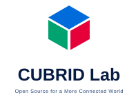

# CUBRID Lab icon gallery

These SVGs are generated by [`scripts/build.py`](../scripts/build.py) from [`tokens/`](../tokens/), [`registry/`](../registry/), and role constructions in the script. The [supplied infographic](studies/repository-icon-system-infographic.png) is the visual reference. It is not a source of SVG paths. Design selection and legal or trademark clearance are separate.

This page shows the icons the generator writes to `dist/icons/`, which holds only approved assets. The [registry](../registry/repositories.json) is the authoritative record of each icon's role, language, and approval status; [PROVENANCE.md](../PROVENANCE.md#review-state) records when and how each was approved ([issue #6](https://github.com/cubrid-lab/brand/issues/6)). A symbol whose registry status is `pending-symbol` is generated under `studies/icons/` instead and is not shown here.

## Individual repository icons

| Role | Repository | Language token | Icon |
| --- | --- | --- | --- |
| Driver | `pycubrid` | Python |  |
| Driver | `cubrid-client` | TypeScript |  |
| Driver | `cubrid-go` | Go |  |
| Driver | `cubrid-rs` | Rust |  |
| ORM | `sqlalchemy-cubrid` | Python |  |
| ORM | `drizzle-cubrid` | TypeScript |  |
| ORM | `gorm-cubrid` | Go |  |
| ORM | `sea-orm-cubrid` | Rust |  |
| MCP | `cubrid-mcp-server` | Python |  |
| Cookbook | `cubrid-cookbook-python` | Python |  |
| Benchmark | `cubrid-benchmark` | Neutral |  |
| Operator | `cubrid-kubernetes-operator` | Go |  |
| Showcase | `showcase` | Neutral |  |

## Community surfaces

`docs` and `community` are concept surfaces in the registry, not claims that repositories with those names exist.

| Surface | Icon |
| --- | --- |
| Docs |  |
| Community |  |

## Size review

The same generated Driver SVG is shown at the study's requested sizes:

| 16 px | 24 px | 32 px | 48 px | 64 px |
| --- | --- | --- | --- | --- |
|  |  |  |  |  |

## Seam review sheet

[`studies/glyph-seams-before-after.png`](studies/glyph-seams-before-after.png) compares every generated repository and surface icon before and after the issue #23 seam backing at 16, 24, 32, 48, 64 and 128 px on light and dark backgrounds. Regenerate it with `python scripts/render_previews.py BEFORE_DIR AFTER_DIR OUT.png` (optional; needs `rsvg-convert` and Pillow, not used by CI).

## Small-size legibility study

[`studies/small-size-legibility.md`](studies/small-size-legibility.md) records white-mark contrast for every language token, mark weight and separation in device pixels, and a pass/fail grade for every icon at 16, 24, 32, 48 and 64 px on light and dark backgrounds (issue #21). Its proposal P2, the enlarged Docs and Showcase marks, was later approved and applied; see [PROVENANCE.md](../PROVENANCE.md#small-size-enlargement-of-docs-and-showcase-issue-21).

## Organization identity

The organization emblem is separate from every repository role icon. The emblem (avatar and profile use) and the horizontal and stacked wordmark lockups, each with a dark-background variant, are generated in `dist/organization/`; their approval status is in [`tokens/organization.json`](../tokens/organization.json) and their scope in [Organization mark usage](ORGANIZATION_MARK_USAGE.md) ([issue #3](https://github.com/cubrid-lab/brand/issues/3)). Two distinct alternative mark studies (`candidate-monochrome-cube.svg` and `candidate-hex-frame.svg`) remain outside `dist/`. Wordmarks use system sans-serif fallbacks; no third-party font is bundled. No visual-asset license is offered, and independent legal/trademark clearance is pending.

| Avatar at 16 px | Approved emblem (64 px) | Monochrome cube study | Open hex-frame study | Horizontal lockup | Stacked lockup |
| --- | --- | --- | --- | --- | --- |
|  |  |  |  |  |  |
