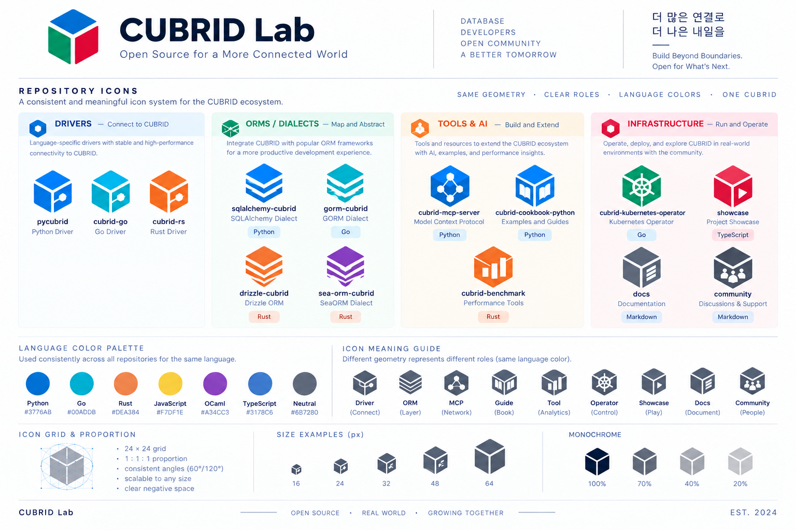

# Repository icon system — design review proposal

**Status:** Historical design study from [issue #4](https://github.com/cubrid-lab/brand/issues/4). The maintainer subsequently selected its icon direction for implementation in [issue #6](https://github.com/cubrid-lab/brand/issues/6). See the current [icon gallery](ICON_GALLERY.md). Organization identity, legal, and trademark review remain separate.

For the current emblem approval and deployment guidance, see [Organization mark usage](ORGANIZATION_MARK_USAGE.md).

This document records the content of a maintainer-supplied repository-icon infographic (October 2026). The original image is preserved below as a **selected visual reference**, outside `dist/`. It is not a generated asset or a second source of SVG geometry, and its inclusion does not expand the visual-asset license. The current Driver construction is in [`tokens/geometry.json`](../tokens/geometry.json); the former Connector Study / 02 remains unchanged as [historical provenance](../provenance/connector-study-02/driver-python.svg).

## System concept

- **Shape = technical role; color = implementation language.** Repositories with the same role share a recognizable symbol; repositories with the same language use the same color token.
- Share a 24×24 construction grid, a 1:1 icon proportion, 60°/120° angles, and clear negative space. “Same geometry” means a shared construction grammar, not an identical silhouette for different roles.
- The four presentation groups are **Drivers** (connect to CUBRID), **ORMs / Dialects** (map and abstract), **Tools & AI** (build and extend), and **Infrastructure** (run and operate). Their blue, green, orange, and red panel accents are presentation aids, not repository color assignments.

The study describes the system as “a consistent and meaningful icon system for the CUBRID ecosystem.” Its group copy proposes stable, high-performance connectivity for Drivers; more productive framework integration for ORMs / Dialects; AI, examples, and performance insights for Tools & AI; and real-world operation, deployment, and community exploration for Infrastructure.

## Repository examples shown in the study

| Group | Repository or surface | Proposed meaning | Language label in study | Registry role / language |
| --- | --- | --- | --- | --- |
| Drivers | `pycubrid` | Python Driver | Python | Driver / Python |
| Drivers | `cubrid-go` | Go Driver | Go | Driver / Go |
| Drivers | `cubrid-rs` | Rust Driver | Rust | Driver / Rust |
| ORMs / Dialects | `sqlalchemy-cubrid` | SQLAlchemy Dialect | Python | ORM / Python |
| ORMs / Dialects | `gorm-cubrid` | GORM Dialect | Go | ORM / Go |
| ORMs / Dialects | `drizzle-cubrid` | Drizzle ORM | Rust | ORM / **TypeScript**; study label conflicts |
| ORMs / Dialects | `sea-orm-cubrid` | SeaORM Dialect | Rust | ORM / Rust |
| Tools & AI | `cubrid-mcp-server` | Model Context Protocol | Python | MCP / Python |
| Tools & AI | `cubrid-cookbook-python` | Examples and Guides | Python | Cookbook / Python |
| Tools & AI | `cubrid-benchmark` | Performance Tools | Rust | Benchmark / **Neutral**; study label conflicts |
| Infrastructure | `cubrid-kubernetes-operator` | Kubernetes Operator | Go | Operator / Go |
| Infrastructure | `showcase` | Project Showcase | TypeScript | Showcase / **Neutral**; [language statistics](https://api.github.com/repos/cubrid-lab/showcase/languages) do not show TypeScript (October 2026) |
| Infrastructure | `docs` | Documentation | Markdown | Docs / Neutral concept surface |
| Infrastructure | `community` | Discussions & Support | Markdown | Community / Neutral concept surface |

The study omits `cubrid-client`, which the registry maps to **Driver / TypeScript**. Current approval status for every entry is in the [registry](../registry/repositories.json). `showcase` uses Neutral because its study label conflicts with its current mixed-content repository. `docs` and `community` are recorded as concept surfaces, not repository names.

## Role meanings used in the generated symbols

| Study label | Meaning | Current registry role |
| --- | --- | --- |
| Driver | Connect | `driver` — cube connector |
| ORM | Layer | `orm` — stacked chevrons |
| MCP | Network | `mcp` — connected nodes |
| Guide | Book | `cookbook` — open book |
| Tool | Analytics | `benchmark` — ascending bars |
| Operator | Control | `operator` — generic six-spoke dial |
| Showcase | Play | `showcase` — play triangle |
| Docs | Document | `docs` — document lines |
| Community | People | `community` — people |

These descriptions guided original vector reconstructions in the generator. The maintainer's newer direction superseded Connector Study / 02 for Driver. The previous SVG remains historical evidence; no third-party logo is incorporated in the new drawings.

## Language palette in the study

| Language or use | Study swatch | Current token |
| --- | --- | --- |
| Python | `#3776AB` | `#3776AB` |
| Go | `#00ADD8` | `#00ADD8` |
| Rust | `#DEA384` | `#DEA384` |
| JavaScript | `#F7DF1E` | `#F7DF1E`; no repository mapped |
| OCaml | `#A34CC3` | `#A34CC3`; no repository mapped |
| TypeScript | `#3178C6` | `#3178C6` |
| Neutral | `#6B7280` | `#6B7280` |

No repository-specific color should be hard-coded where a language token exists. These are CUBRID Lab internal design tokens, not official CUBRID brand colors or claims about language brands.

## Construction and preview checks

- Draw and review on a 24×24 grid with consistent 60°/120° rhombus corners and open negative space. The raster cannot supply exact vector parameters; the selected numerical reconstruction lives in the geometry token.
- Preview proposed symbols at **16, 24, 32, 48, and 64 px**. Check legibility at 16 px and consistency at each size.
- Preview a monochrome version at **100%, 70%, 40%, and 20%** opacity. The study shows these examples; their contrast and accessibility are not yet validated.
- Test each role in its language colors. Organization identity candidates and any future experimental concepts stay outside `dist/`.

## Organization identity and copy

The study depicts a separate cube-like **CUBRID Lab** emblem and wordmark, plus these proposed lines:

> Open Source for a More Connected World
>
> Database · Developers · Open Community · A Better Tomorrow
>
> More connections, a better tomorrow (English rendering of the study's Korean line)
>
> Build Beyond Boundaries. Open for What's Next.

It also uses **“Same geometry · Clear roles · Language colors · One CUBRID”**, **“Open source · Real world · Growing together”**, and **“Est. 2024.”** These are unapproved copy proposals. “One CUBRID” requires particular care because CUBRID Lab is independent of CUBRID Corporation and the official CUBRID project; keep the [independence notice](../BRAND_USAGE.md) prominent and review the wording before publication.

The organization emblem and wordmark belong to [issue #3](https://github.com/cubrid-lab/brand/issues/3). The Driver role symbol is not the organization logo. No organization avatar, profile, or identity asset changes followed directly from this initial study before the separate review in issue #3.

## Implementation decisions and remaining review

1. The registry uses TypeScript for Drizzle and Neutral for Benchmark and Showcase. Docs and Community are concept surfaces. JavaScript and OCaml tokens are defined but currently unused.
2. The maintainer selected the cube-based Driver direction, whose variants replaced the former assets in `dist/icons/`, and later approved further role and surface symbols in [issue #6](https://github.com/cubrid-lab/brand/issues/6). The [registry](../registry/repositories.json) holds the current approval status, [PROVENANCE.md](../PROVENANCE.md#review-state) the decision history, and the [gallery](ICON_GALLERY.md) the generated icons.
3. The three-color organization emblem and the wordmark lockups later received scoped design and own-organization-use approvals under [issue #3](https://github.com/cubrid-lab/brand/issues/3); their current status is in [`tokens/organization.json`](../tokens/organization.json) and their scope in [Organization mark usage](ORGANIZATION_MARK_USAGE.md). The other copy proposals and similarity/trademark searches remain pending.
4. Perform independent post-implementation review and complete legal work before broad deployment. No visual-asset license is offered; see [Brand usage and legal status](../BRAND_USAGE.md).
